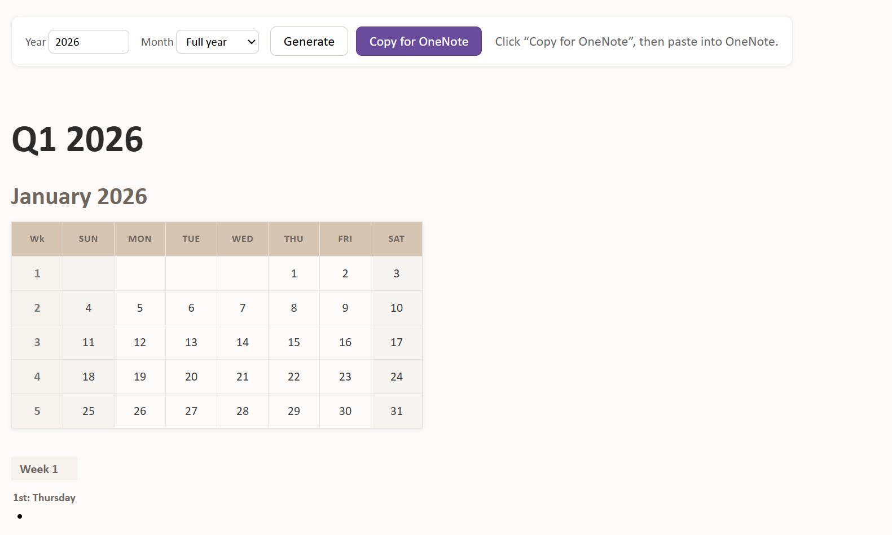

# Daily Activities Calendar

A lightweight browser-based planner that generates yearly, quarterly, and monthly activity planning templates that can be copied directly into Microsoft OneNote.

## Live Demo

🔗 https://gin-2710.github.io/Daily_Activities_Calendar/index.html

---

## Overview

Daily Activities Calendar helps users create structured planning templates for an entire year or for individual months.

The planner automatically generates:

- Quarterly sections (Q1-Q4)
- Monthly calendar views
- Week-based planning blocks
- Daily activity placeholders (Monday-Friday)
- OneNote-ready formatting
- Print-friendly layouts

Everything runs directly in the browser with no installation, login, or backend services required.

---

## Features

### Yearly Planning

Generate a complete planner for any year with all 12 months organized into quarterly sections.

### Monthly Planning

Focus on a specific month when detailed planning is required.

### Weekly Activity Sections

Each week includes dedicated planning areas for:

- Monday
- Tuesday
- Wednesday
- Thursday
- Friday

### OneNote Integration

Copy generated planner content directly into Microsoft OneNote using the **Copy for OneNote** button.

### Print Friendly

The planner automatically hides controls when printing.

### Color-Coded Months

Each month includes a unique color theme to improve readability and organization.

### No Dependencies

Built entirely with:

- HTML5
- CSS3
- Vanilla JavaScript

No frameworks or libraries are required.

---

## How to Use

### Generate a Planner

1. Open the planner.
2. Enter the desired year.
3. Select:
   - Full year, or
   - A specific month.
4. Click **Generate**.

### Copy to OneNote

1. Generate the desired planner.
2. Click **Copy for OneNote**.
3. Open Microsoft OneNote.
4. Paste the copied content.

### Print

Press:

- **Ctrl + P** (Windows)
- **Cmd + P** (Mac)

The toolbar is automatically hidden during printing.

---

## Browser Compatibility

Tested with:

- Microsoft Edge
- Google Chrome
- Brave

The planner uses modern Clipboard APIs. Browser behavior may vary depending on security settings and permissions.

---

## Project Structure

```text
Daily_Activities_Calendar/
│
├── index.html
├── README.md
└── LICENSE
```

---

## Technology Stack

| Technology | Purpose |
|------------|---------|
| HTML5 | Structure |
| CSS3 | Styling |
| JavaScript (ES6+) | Planner generation and interaction |
| Clipboard API | To copy data to clipboard |

---

## Use Cases

- Personal productivity planning
- Activity scheduling
- Goal tracking
- Weekly task organization
- Academic planning
- Project planning
- OneNote template generation

---

## Future Enhancements

Potential future improvements:

- Custom color themes
- Weekend planning sections
- Holiday highlighting
- PDF export
- Editable templates
- Dark mode

---

## Screenshots


---

Contributions, suggestions, and improvements are welcome.

If you find a bug or have a feature request, feel free to open an issue or submit a pull request.

---

## License

Licensed under the Apache License 2.0.

See the LICENSE file for details.

---

## Author

Created by **gin-2710**.

GitHub Repository:
https://github.com/gin-2710/Daily_Activities_Calendar
